# MobiSocial: Transporte e Mobilidade Urbana Inclusiva

Criação de Rotas, Agendamento de Corridas, Compartilhamento de Veículos e Gestão de Pagamentos e Tarifas Sociais documentado com C4 Model (Structurizr).

## 1. Definição do Produto e Escopo

### 1.1. Visão Geral do Produto
O **MobiSocial** é uma plataforma de transporte e mobilidade urbana voltada para a criação de rotas inteligentes, agendamento de corridas individuais ou compartilhadas (*carpooling*), gerenciamento de passageiros e motoristas e processamento de pagamentos (incluindo rateio automático de tarifas e subsídios sociais para estudantes e pacientes em deslocamento para Unidades Básicas de Saúde e hospitais). O sistema é construído sob uma **Arquitetura Orientada a Serviços (SOA)** integrada de forma assíncrona por uma **Arquitetura Baseada em Eventos (Event-Driven)** com Spring Boot e RabbitMQ.

#### Problemas Reais Solucionados
- **Otimização e Compartilhamento de Veículos (*Carpooling*):** Reduz o custo individual de deslocamento e o congestionamento urbano ao agrupar passageiros com origens, paradas e destinos compatíveis na mesma rota planejada, aproveitando a capacidade ociosa dos veículos.
- **Acesso à Educação e Saúde (Tarifa Social e Rotas Prioritárias):** Conecta estudantes universitários e pacientes de UBS/hospitais a rotas acessíveis, permitindo pagamentos simplificados com rateio solidário, PIX/cartão ou aplicação automática de desconto de tarifa social.
- **Processamento Assíncrono em Horários de Pico:** Em horários de alta demanda, o agendamento de corridas, o cálculo de divisão tarifária e o disparo de notificações ocorrem de forma desacoplada via mensageria, evitando gargalos e lentidão para passageiros e motoristas.

### 1.2. Catálogo de Atores e Sistemas Externos
Abaixo estão definidos os atores e os sistemas externos que interagem diretamente com o **MobiSocial**, servindo de base para o **Diagrama de Contexto (C4 Nível 1)**:

#### Atores (*Persons*)
| Ator | Perfil / Papel | Principais Interações com o Sistema |
|:-----|:---------------|:------------------------------------|
| **Passageiro** | Cidadão comum, Estudante ou Paciente de UBS. | Consulta rotas disponíveis, agenda corridas individuais ou compartilhadas, realiza pagamentos com rateio/tarifa social e recebe notificações da viagem. |
| **Motorista Parceiro** | Condutor credenciado ou motorista de frota urbana. | Cadastra veículo e capacidade de assentos, cria ou aceita rotas urbanas planejadas e visualiza a lista de passageiros embarcados. |

#### Sistemas Externos (*External Systems*)
| Sistema Externo | Tipo | Principais Interações com o Sistema |
|:----------------|:-----|:------------------------------------|
| **Gateway Externo de Pagamentos** | Sistema Externo (API REST / HTTPS) | Processa a cobrança eletrônica das corridas, rateios e validação de vouchers sociais. |
| **API de Mapas / Geolocalização** | Sistema Externo (API REST / HTTPS) | Fornece cálculo de distância em quilômetros, estimativa de tempo de percurso e traçado de rotas urbanas. |

### 1.3. Funcionalidades Documentadas (Requisitos Funcionais)

| Requisito | Funcionalidade | Descrição |
|:----------|:---------------|:----------|
| **RF01** | **Gerenciar usuários, autenticação e veículos** | Cadastrar passageiros e motoristas no **Serviço de Usuários** (`/api/users`, `/api/auth`), realizar login com emissão de token **JWT**, definir perfis tarifários (`COMUM`, `ESTUDANTE`, `SOCIAL`) e gerenciar veículos e capacidade máxima de assentos. |
| **RF02** | **Criar e consultar rotas urbanas** | Permitir a criação e consulta de rotas (`/api/routes`) contendo ponto de partida, paradas intermediárias, destino final, horário de saída e assentos disponíveis. |
| **RF03** | **Agendar corridas e compartilhar veículos** | Receber solicitações autenticadas via API REST (`POST /api/rides`), validar o **JWT**, consultar o perfil tarifário do passageiro no **Serviço de Usuários**, consultar rotas e distâncias na **API de Mapas / Geolocalização**, parear o passageiro respeitando o limite de assentos e confirmar a reserva compartilhada. |
| **RF04** | **Processar pagamentos e rateio de tarifa** | Calcular o valor final da viagem aplicando a divisão de custos entre passageiros da mesma rota ou descontos de tarifa social e processar a transação financeira via evento assíncrono (`payments.process`) integrando com o **Gateway Externo de Pagamentos**. |
| **RF05** | **Notificar status de corridas e pagamentos** | Consumir eventos da fila `notifications.dispatch`, emitir avisos de confirmação de corrida e pagamento ao passageiro e ao motorista e registrar os envios no PostgreSQL. |

### 1.4. Resumo do Fluxo Principal

1. O passageiro realiza o cadastro (`POST /api/users`) e o login (`POST /api/auth/login`) no **Serviço de Usuários**, obtendo um token **JWT** e mantendo seu perfil tarifário (`COMUM`, `ESTUDANTE` ou `SOCIAL`) persistido no PostgreSQL.
2. Em seguida, o passageiro envia uma requisição HTTP autenticada (`POST /api/rides`) com o cabeçalho `Authorization: Bearer <TOKEN_JWT>` ao **Serviço de Rotas e Corridas** (também responsável pelos endpoints `/api/routes`), informando a rota desejada, se é corrida compartilhada e o método de pagamento.
3. O **Serviço de Rotas e Corridas** valida o JWT recebido, consulta via HTTP/REST o perfil tarifário do passageiro no **Serviço de Usuários**, consulta via HTTPS rotas e distâncias na **API de Mapas / Geolocalização**, verifica a disponibilidade de assentos, persiste o agendamento no PostgreSQL com status `AGUARDANDO_PAGAMENTO` e publica um evento na fila `payments.process` do RabbitMQ, liberando imediatamente a resposta HTTP.
4. O **Serviço de Pagamentos** consome o evento da fila `payments.process`, aplica a regra de rateio entre passageiros (ou desconto de tarifa social), executa a cobrança via HTTPS no **Gateway Externo de Pagamentos** e salva a transação no PostgreSQL.
5. Após aprovar a cobrança, o **Serviço de Pagamentos** publica um evento na fila `notifications.dispatch` do RabbitMQ.
6. O **Serviço de Notificações** consome o evento da fila `notifications.dispatch`, emite o aviso final de corrida e pagamento confirmado e registra os envios no PostgreSQL.

## 2. Estilos Arquiteturais Selecionados

Para atender aos requisitos do **Tema 13 (Aplicativo de Transporte e Mobilidade Urbana)**, o projeto combina dois estilos arquiteturais:

### 2.1. Arquitetura Orientada a Serviços (SOA — Service-Oriented Architecture)
- **Aplicação no Sistema:** Além da **Aplicação Front-end** (`Web App (SPA)`) modelada no C4 Nível 2 — que consome as APIs REST `/api/users`, `/api/auth`, `/api/rides` e `/api/routes` —, o back-end em **Spring Boot** é decomposto em **quatro serviços modulares** orientados a capacidades de negócio independentes, apoiados pelos pacotes transversais `config` (`RabbitMQConfig`, `SecurityConfig`) e `event` (contratos JSON AMQP) e pelo banco **PostgreSQL** (com previsão de schema por serviço conforme o C4 Nível 2):
  * **Serviço de Usuários (`userService` — pacote `user`):** Responsável pelo cadastro de usuários e motoristas/veículos, login com emissão de JWT e gerenciamento dos perfis tarifários (`COMUM`, `ESTUDANTE`, `SOCIAL`) via API REST (`AuthController`, `UserController`, `AuthService`, `UserService`, `UserRepository`).
  * **Serviço de Rotas e Corridas (`rideService` — pacote `ride`):** Responsável pelo cadastro de trajetos (`/api/routes`), controle de capacidade dos veículos, agendamento de corridas compartilhadas (`/api/rides`), validação de JWT, consulta de perfil tarifário e geolocalização, e publicação de eventos (`RouteController`, `RideController`, `RideService`, `RouteMatchingComponent`, `UserServiceClient`, `MapsClient`, `RideEventPublisher`, `RouteRepository`, `RideRepository`).
  * **Serviço de Pagamentos (`paymentService` — pacote `payment`):** Responsável pelo consumo da fila `payments.process`, cálculo de divisão tarifária (*carpooling*), aplicação de subsídio social, cobrança no gateway externo e publicação na fila `notifications.dispatch` (`PaymentEventListener`, `PaymentService`, `PaymentGatewayClient`, `PaymentRepository`, `PaymentEventPublisher`).
  * **Serviço de Notificações (`notificationService` — pacote `notification`):** Responsável pelo consumo da fila `notifications.dispatch`, emissão de avisos de corrida e pagamento e registro dos envios no PostgreSQL (`NotificationEventListener`, `NotificationService`, `NotificationRepository`).
- **Justificativa Arquitetural:** A abordagem **SOA** permite separar claramente as regras de identidade e perfis tarifários (usuários), mobilidade urbana (rotas e lotação), regras financeiras (pagamentos e vouchers) e avisos (notificações), garantindo baixo acoplamento, alta coesão e facilidade de manutenção por duplas em paralelo.

### 2.2. Arquitetura Baseada em Eventos (Event-Driven Architecture)
- **Aplicação no Sistema:** A comunicação entre os serviços SOA após a solicitação da corrida ocorre de forma totalmente assíncrona por meio do **RabbitMQ** (protocolo `AMQP`), utilizando as filas `payments.process` e `notifications.dispatch`.
- **Justificativa Arquitetural:** Em horários de pico no trânsito urbano, centenas de solicitações de agendamento e rateio ocorrem simultaneamente. O estilo orientado a eventos garante **desacoplamento temporal**: o Serviço de Rotas e Corridas confirma a reserva do assento rapidamente via HTTP e delega o processamento financeiro e o envio de avisos para processamento assíncrono em background, aumentando a resiliência e a escalabilidade do sistema.

## 3. Documentação Arquitetural (Modelo C4 - Structurizr)

O código-fonte da modelagem arquitetural encontra-se em [`/docs/c4/workspace.dsl`](./docs/c4/workspace.dsl). As Decisões Arquiteturais (ADRs) estão documentadas em [`/docs/adr/`](./docs/adr/) e o guia de contribuição em [`/docs/CONTRIBUTING.md`](./docs/CONTRIBUTING.md).

### 3.1. C4 Nível 1: Diagrama de Contexto


O Passageiro e o Motorista acessam o MobiSocial por **HTTPS**. Para processar cobranças e calcular rotas, o sistema chama o Gateway de Pagamentos e a API de Mapas, também por **HTTPS**.

### 3.2. C4 Nível 2: Diagrama de Container


O Front-end se comunica com o Serviço de Usuários e com o Serviço de Rotas e Corridas por **HTTPS/REST** (JSON). O Serviço de Rotas e Corridas consulta o perfil tarifário do passageiro no Serviço de Usuários por **HTTP/REST** e chama a API de Mapas por **HTTPS** para calcular rotas e distâncias. O processamento de pagamento e notificação é assíncrono: o Serviço de Rotas e Corridas publica um evento na fila `payments.process` do RabbitMQ, o Serviço de Pagamentos o consome, faz a cobrança no Gateway Externo por **HTTPS** e publica em `notifications.dispatch`, que o Serviço de Notificações consome. As mensagens entre esses serviços trafegam por **AMQP**, e os serviços gravam seus dados no PostgreSQL via **JDBC**.

#### Fluxos Dinâmicos

##### 1. Autenticação
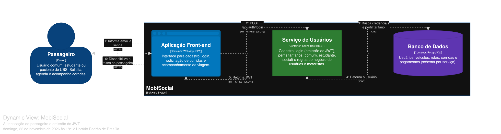

O Passageiro informa suas credenciais ao Front-end, que chama o Serviço de Usuários. O serviço consulta o PostgreSQL, valida o perfil tarifário e retorna o token JWT ao Passageiro.

##### 2. Agendamento
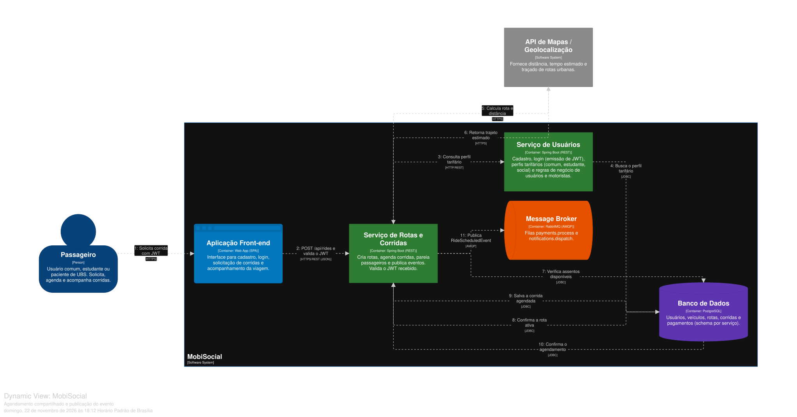

O Passageiro envia uma requisição autenticada ao Serviço de Rotas e Corridas. O serviço valida o JWT, consulta o perfil tarifário e a API de Mapas, verifica os assentos disponíveis, persiste a corrida no PostgreSQL e publica `RideScheduledEvent` no broker.

##### 3. Pagamento e rateio
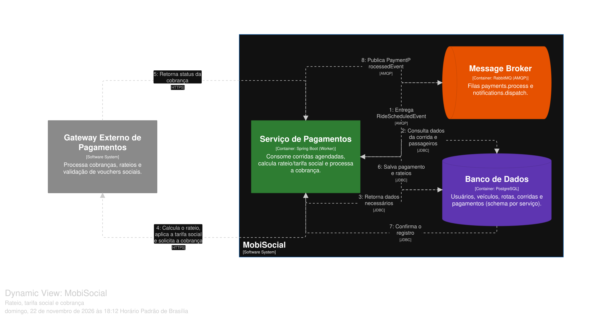

O Serviço de Pagamentos recebe `RideScheduledEvent`, consulta os dados necessários no PostgreSQL, calcula o rateio e aplica a tarifa social. Em seguida, solicita a cobrança ao Gateway Externo, salva o resultado no banco e publica `PaymentProcessedEvent` no broker.

##### 4. Notificação
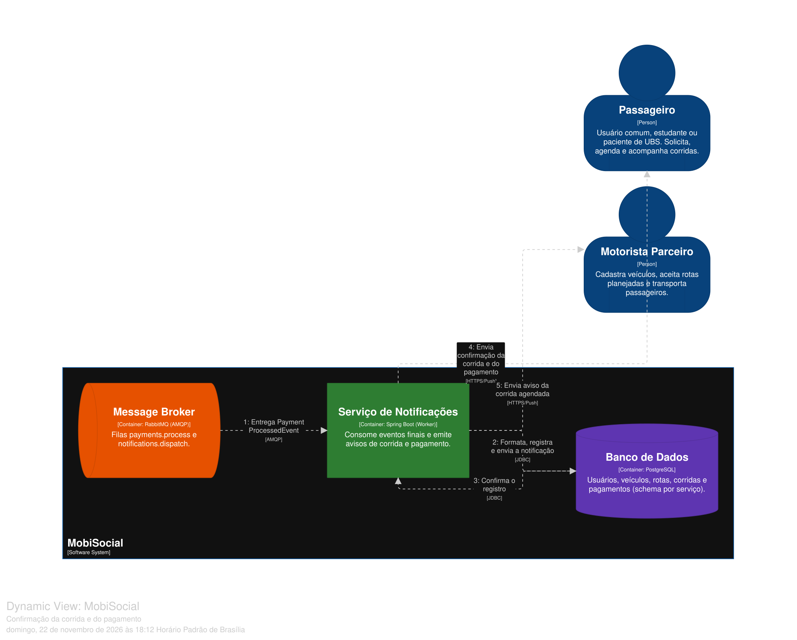

O Serviço de Notificações consome `PaymentProcessedEvent`, formata e registra a confirmação no PostgreSQL e envia o resultado ao Passageiro e ao Motorista.

### 3.3. C4 Nível 3: Diagramas de Componentes

#### Serviço de Usuários
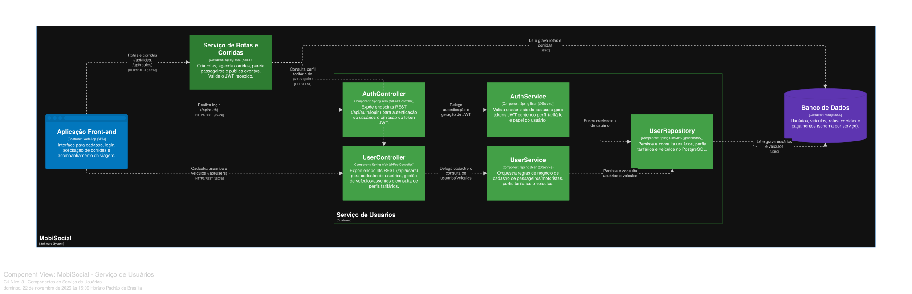

O **Serviço de Usuários** recebe requisições do **Front-end** via **HTTPS/REST** (JSON) nos controladores `AuthController` (`/api/auth`) e `UserController` (`/api/users`). O `AuthController` delega ao `AuthService` a validação de credenciais e a emissão do token **JWT**, enquanto o `UserController` delega ao `UserService` o cadastro de passageiros e motoristas, a gestão de veículos/assentos e a consulta de perfis tarifários (`COMUM`, `ESTUDANTE`, `SOCIAL`). Além disso, o `UserController` atende requisições internas via **HTTP/REST** do **Serviço de Rotas e Corridas** (`UserServiceClient`) para verificação de perfil tarifário, e os dados de usuários e veículos são persistidos no **PostgreSQL** por meio do `UserRepository` (**JDBC**).

#### Serviço de Rotas e Corridas
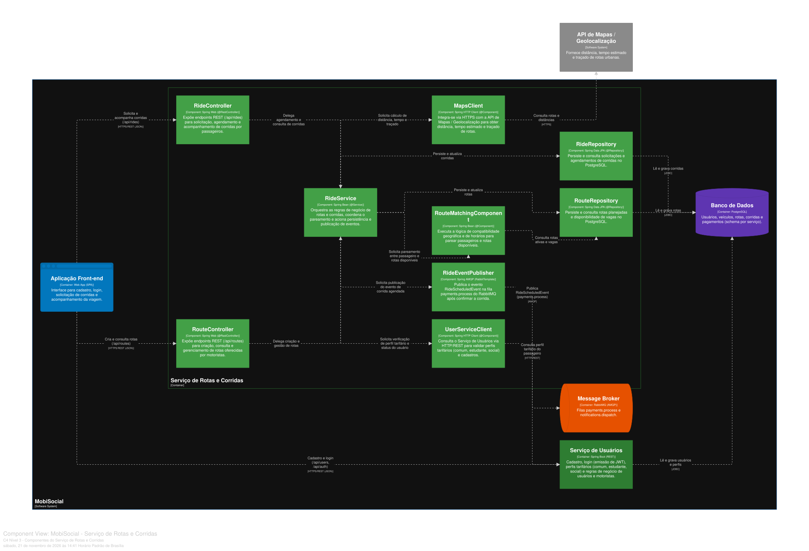

O **Serviço de Rotas e Corridas** recebe requisições do **Front-end** via **HTTPS/REST** (JSON) nos controladores `RouteController` (`/api/routes`) e `RideController` (`/api/rides`), delegando as regras de negócio ao `RideService`. O `RideService` utiliza o `RouteMatchingComponent` para parear passageiros e rotas compatíveis, consulta o perfil tarifário no **Serviço de Usuários** via `UserServiceClient` (**HTTP/REST**), calcula rotas e distâncias na **API de Mapas / Geolocalização** via `MapsClient` (**HTTPS**), persiste rotas e corridas no **PostgreSQL** por meio de `RouteRepository` e `RideRepository` (**JDBC**) e publica o evento `RideScheduledEvent` na fila `payments.process` do **RabbitMQ** através do `RideEventPublisher` (**AMQP**).

#### Message Broker (RabbitMQ — Filas AMQP)
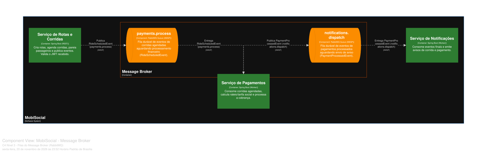

O Message Broker organiza o fluxo assíncrono em duas filas duráveis via **AMQP**: `payments.process`, que recebe o evento `RideScheduledEvent` do **Serviço de Rotas e Corridas** e o entrega ao **Serviço de Pagamentos**, e `notifications.dispatch`, que recebe o evento `PaymentProcessedEvent` do **Serviço de Pagamentos** e o entrega ao **Serviço de Notificações**.

#### Serviço de Pagamentos
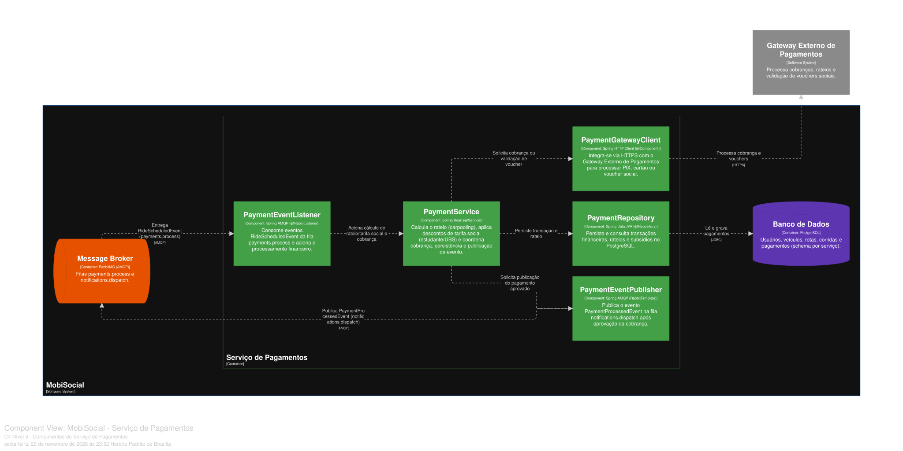

O `PaymentEventListener` consome o evento `RideScheduledEvent` da fila `payments.process` (**AMQP**) e aciona o `PaymentService`, responsável pelo cálculo de rateio (*carpooling*) e aplicação de tarifa social (estudante/UBS). O `PaymentService` solicita a cobrança ao **Gateway Externo de Pagamentos** via `PaymentGatewayClient` (**HTTPS**), persiste a transação no **PostgreSQL** via `PaymentRepository` (**JDBC**) e dispara o evento `PaymentProcessedEvent` na fila `notifications.dispatch` por meio do `PaymentEventPublisher` (**AMQP**).

#### Serviço de Notificações
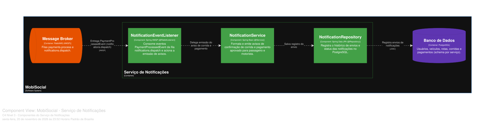

O `NotificationEventListener` consome o evento `PaymentProcessedEvent` da fila `notifications.dispatch` (**AMQP**) e delega ao `NotificationService` a formatação e emissão dos avisos de corrida e pagamento aprovado. Em seguida, o `NotificationRepository` grava o histórico de envios no **PostgreSQL** via **JDBC**.

### 3.4. C4 Nível 4: Diagramas de Código e Classes

#### Diagramas de Código no Structurizr (`workspace.dsl`)

##### Serviço de Rotas e Corridas (Classes, Interfaces JPA, Entidades e Eventos)
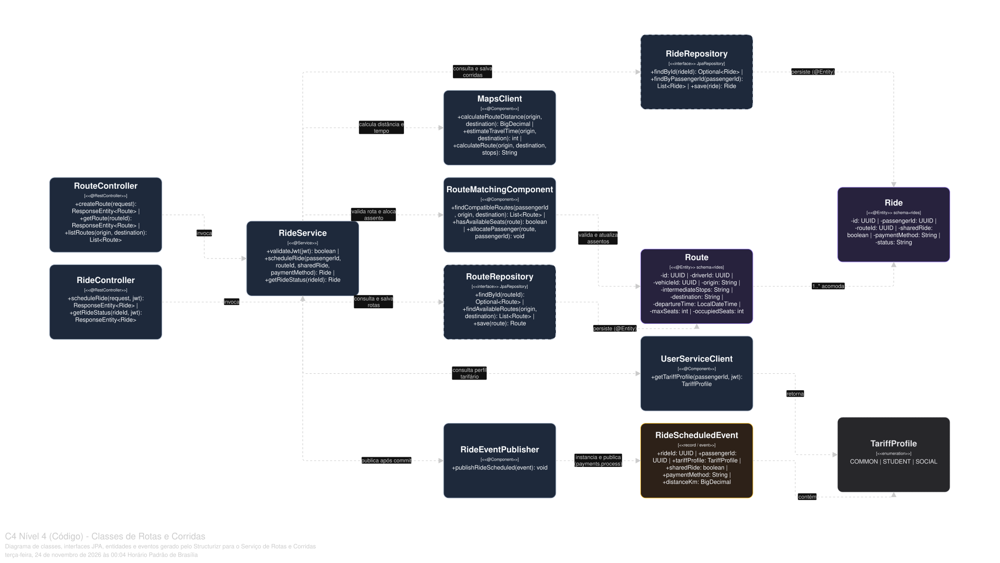

Modela diretamente no Structurizr as classes (`RouteController`, `RideController`, `RideService`, `RouteMatchingComponent`, `UserServiceClient`, `MapsClient`, `RideEventPublisher`), interfaces JPA (`RouteRepository`, `RideRepository`), entidades (`Route` e `Ride`, no schema `rides`) e contratos de evento (`RideScheduledEvent` e `TariffProfile`) do pacote `br.ufc.quixada.arquitetura.mobisocial.ride`.

##### Serviço de Pagamentos (Classes, Interface JPA, Entidade e Eventos)
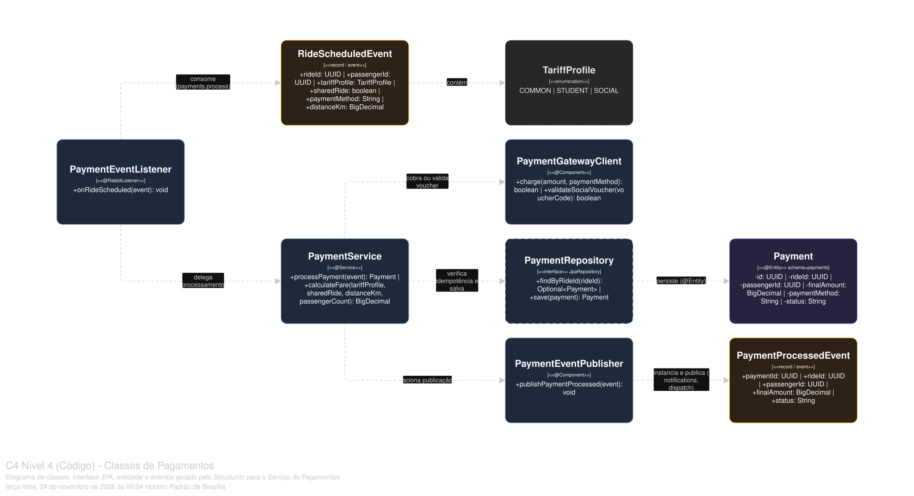

Modela diretamente no Structurizr o consumidor AMQP (`PaymentEventListener`), o serviço de cálculo de rateio e tarifa social (`PaymentService`), o cliente HTTPS do gateway (`PaymentGatewayClient`), a interface JPA (`PaymentRepository`), a entidade `Payment` (no schema `payments`), o publicador (`PaymentEventPublisher`) e os eventos `RideScheduledEvent` e `PaymentProcessedEvent`.

#### Diagramas de Classes (Mermaid — Detalhamento por Serviço)

##### Serviço de Usuários

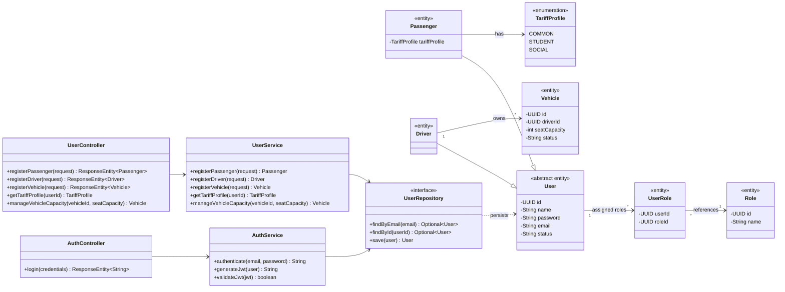

##### Serviço de Rotas e Corridas

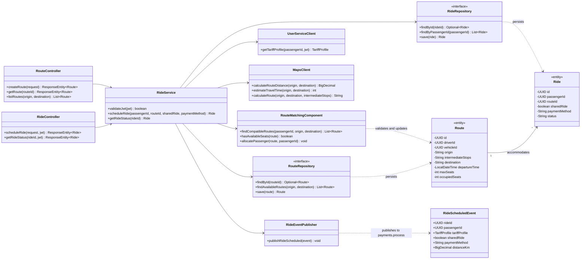

##### Serviço de Pagamentos

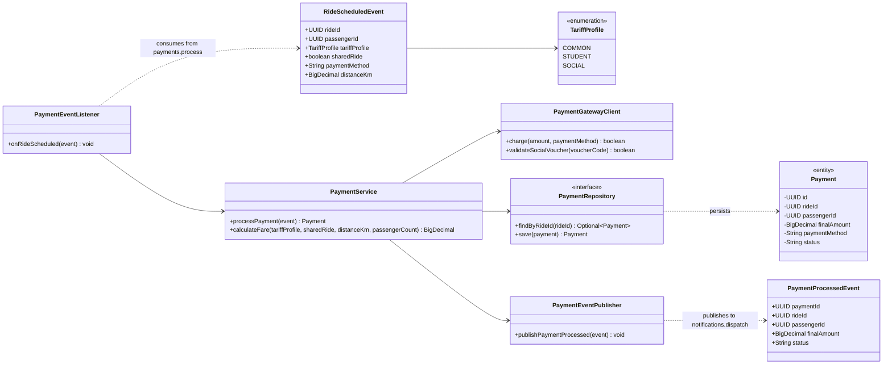

##### Serviço de Notificações

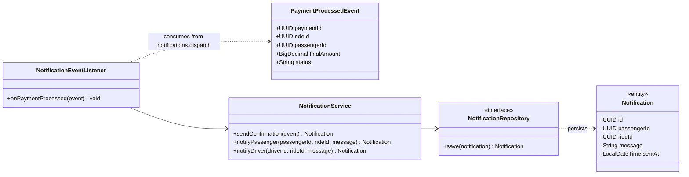

## 4. Guia Passo a Passo de Execução do Projeto

> *Nota: Os comandos abaixo descrevem o procedimento completo de execução da implementação parcial do fluxo principal em Spring Boot.*

### Pré-requisitos
- **Docker** e **Docker Compose**
- **Java JDK 17+** e **Maven**
- **Postman**, **Insomnia** ou **cURL** (para disparar requisições HTTP aos endpoints REST)

### 4.1. Subir a Infraestrutura (RabbitMQ e PostgreSQL)
Na raiz do repositório, inicie os containers do Message Broker e do Banco de Dados via Docker Compose:
```bash
docker compose up -d
```
- **RabbitMQ (AMQP):** `localhost:5672` | **Painel Web:** `http://localhost:15672`
- **PostgreSQL:** `localhost:5432`

### 4.2. Executar a Aplicação Spring Boot
Na raiz do repositório, inicie os serviços do MobiSocial utilizando o Maven Wrapper:
```bash
./mvnw spring-boot:run
```

### 4.3. Testar o Fluxo Principal (Usuários/JWT + Agendamento + Evento de Pagamento + Notificação)
Com a aplicação rodando na porta `8080`, execute as requisições abaixo pelo Postman, Insomnia ou via terminal (`curl`) para cadastrar um passageiro no **Serviço de Usuários**, autenticar-se para obter o token **JWT** e agendar uma corrida compartilhada no **Serviço de Rotas e Corridas** (que valida o JWT, consulta o perfil tarifário do passageiro no **Serviço de Usuários** e publica o evento na fila `payments.process`):

1. **Cadastrar passageiro com perfil tarifário (`POST /api/users`):**
```bash
curl -X POST http://localhost:8080/api/users \
  -H "Content-Type: application/json" \
  -d '{
    "name": "Ana Silva",
    "email": "ana@alu.ufc.br",
    "password": "senha-segura",
    "tariffProfile": "ESTUDANTE"
  }'
```

2. **Autenticar usuário para obter o token JWT (`POST /api/auth/login`):**
```bash
curl -X POST http://localhost:8080/api/auth/login \
  -H "Content-Type: application/json" \
  -d '{
    "email": "ana@alu.ufc.br",
    "password": "senha-segura"
  }'
```

3. **Agendar corrida compartilhada com JWT (`POST /api/rides`):**
```bash
curl -X POST http://localhost:8080/api/rides \
  -H "Content-Type: application/json" \
  -H "Authorization: Bearer <TOKEN_JWT>" \
  -d '{
    "passengerId": 1,
    "routeId": 10,
    "sharedRide": true,
    "paymentMethod": "PIX"
  }'
```

## 5. Cronograma e Divisão de Atividades da Equipe

**Integrantes (Equipe 10):** Felipe Maia, João Vitor, Maria José, Cauan Ricardo, Clidenor e Pablo.

| Etapa | Prazo Oficial | Dupla Responsável | Entregável Principal | Foco Técnico da Frente |
| :--- | :--- | :--- | :--- | :--- |
| **Etapa 1** | 16/11 | **Dupla A:** Felipe Maia e Clidenor | Repositório GitHub e Estilos | Criar repo, adicionar equipe, estruturar pastas (`/docs/c4`, `/docs/adr`, `/src`), justificar SOA + Event-Driven no `README.md`, guia de execução e importar dependências do Spring Boot. |
| **Etapa 1** | 16/11 | **Dupla B:** Pablo e Maria | Escopo MobiSocial e Requisitos | Documentar o problema de Mobilidade Urbana, atores, funcionalidades (RF01-RF05) e fluxo principal no `README.md`. |
| **Etapa 1** | 16/11 | **Dupla C:** Cauan Ricardo e João Vitor | Diagramas C4 Níveis 1 e 2 | Configurar Structurizr DSL (`workspace.dsl`) e gerar os diagramas de Contexto e Container alinhados ao `README.md`. |
| **Etapa 2** | 23/11 | **Dupla A:** Felipe Maia e Clidenor | C4 Nível 3 (Pagamentos e Notificações) | Modelar os componentes internos do **Serviço de Pagamentos** (`PaymentEventListener`, `PaymentService`, `PaymentGatewayClient`, `PaymentRepository`, `PaymentEventPublisher`), filas do RabbitMQ (`payments.process` e `notifications.dispatch`) e **Serviço de Notificações** (`NotificationEventListener`, `NotificationService`, `NotificationRepository`). |
| **Etapa 2** | 23/11 | **Dupla B:** Pablo e Maria | C4 Nível 3 (Usuários, Rotas e Corridas) | Modelar os componentes internos do **Serviço de Usuários** (`AuthController`, `UserController`, `AuthService`, `UserService`, `UserRepository`) e do **Serviço de Rotas e Corridas** (`RouteController`, `RideController`, `RideService`, `RouteMatchingComponent`, `UserServiceClient`, `MapsClient`, `RideEventPublisher`, `RouteRepository`, `RideRepository`). |
| **Etapa 2** | 23/11 | **Dupla C:** Cauan Ricardo e João Vitor | C4 Nível 4 (Fluxos) e ADRs | Modelar os fluxos dinâmicos de autenticação, agendamento, pagamento/rateio e notificação e redigir as Decisões Arquiteturais (ADRs 01, 02 e 03) em `/docs/adr`. |
| **Etapa 3** | 01/12 | **Dupla A:** Felipe Maia e Clidenor | Infra Docker e Pagamentos | Subir Docker Compose (RabbitMQ + PostgreSQL), configurar filas AMQP (`RabbitMQConfig`) e implementar o **Serviço de Pagamentos** (`PaymentEventListener`, `PaymentService`, `PaymentGatewayClient`, `PaymentRepository`, `PaymentEventPublisher`). |
| **Etapa 3** | 01/12 | **Dupla B:** Pablo e Maria | Serviços de Usuários, Rotas e Corridas | Implementar o **Serviço de Usuários** (`/api/users`, `/api/auth` com JWT e perfis tarifários) e o **Serviço de Rotas e Corridas** (`/api/routes`, `POST /api/rides`, validação de JWT, consulta ao Serviço de Usuários, alocação em rota compartilhada e publicação de evento em `payments.process`). |
| **Etapa 3** | 01/12 | **Dupla C:** Cauan Ricardo e João Vitor | Notificações, Conformidade e Slides | Implementar o **Serviço de Notificações** (`NotificationEventListener`, `NotificationService`, `NotificationRepository`), auditar conformidade código x Structurizr e preparar apresentação. |