# Documentação Arquitetural (Modelo C4 — Structurizr)

[← Voltar ao README principal](../../README.md) · [Arquitetura e Estilos](../arquitetura.md) · [ADRs](../adr/README.md) · [Contribuição](../CONTRIBUTING.md)

---

O código-fonte da modelagem arquitetural encontra-se em [`workspace.dsl`](./workspace.dsl). As Decisões Arquiteturais (ADRs) estão documentadas em [`docs/adr/`](../adr/README.md) e o guia de contribuição em [`docs/CONTRIBUTING.md`](../CONTRIBUTING.md).

> **Dica:** Para visualizar e navegar pelos diagramas interativamente no Structurizr local, execute na raiz do repositório:
> ```bash
> docker run -it --rm -p 8080:8080 -v "$PWD/docs/c4:/usr/local/structurizr" structurizr/structurizr local
> ```

---

## 1. C4 Nível 1: Diagrama de Contexto


O Passageiro e o Motorista acessam o MobiSocial por **HTTPS**. Para processar cobranças e calcular rotas, o sistema chama o Gateway de Pagamentos e a API de Mapas, também por **HTTPS**.

## 2. C4 Nível 2: Diagrama de Container


O Front-end se comunica com o Serviço de Usuários e com o Serviço de Rotas e Corridas por **HTTPS/REST** (JSON). O Serviço de Rotas e Corridas consulta o perfil tarifário do passageiro no Serviço de Usuários por **HTTP/REST** e chama a API de Mapas por **HTTPS** para calcular rotas e distâncias. O processamento de pagamento e notificação é assíncrono: o Serviço de Rotas e Corridas publica um evento na fila `payments.process` do RabbitMQ, o Serviço de Pagamentos o consome, faz a cobrança no Gateway Externo por **HTTPS** e publica em `notifications.dispatch`, que o Serviço de Notificações consome. As mensagens entre esses serviços trafegam por **AMQP**, e os serviços gravam seus dados no PostgreSQL via **JDBC**.

### Fluxos Dinâmicos

#### 1. Autenticação
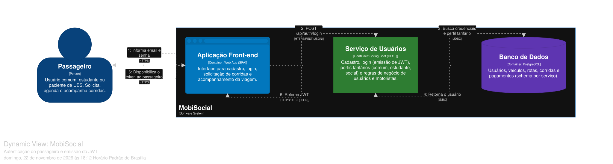

O Passageiro informa suas credenciais ao Front-end, que chama o Serviço de Usuários. O serviço consulta o PostgreSQL, valida o perfil tarifário e retorna o token JWT ao Passageiro.

#### 2. Agendamento
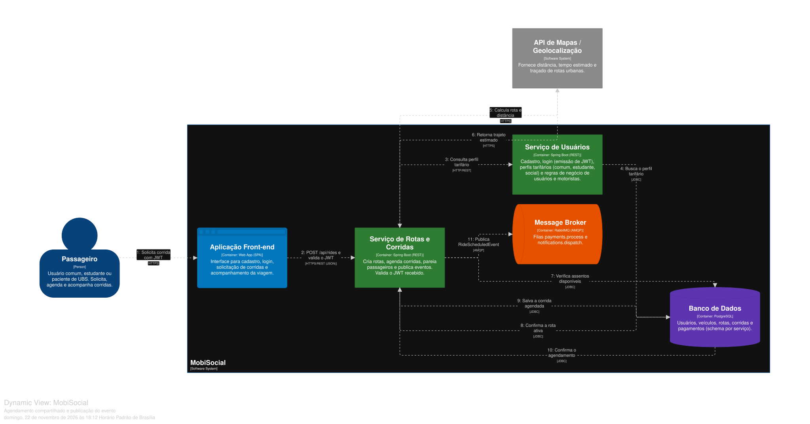

O Passageiro envia uma requisição autenticada ao Serviço de Rotas e Corridas. O serviço valida o JWT, consulta o perfil tarifário e a API de Mapas, verifica os assentos disponíveis, persiste a corrida no PostgreSQL e publica `RideScheduledEvent` no broker.

#### 3. Pagamento e rateio
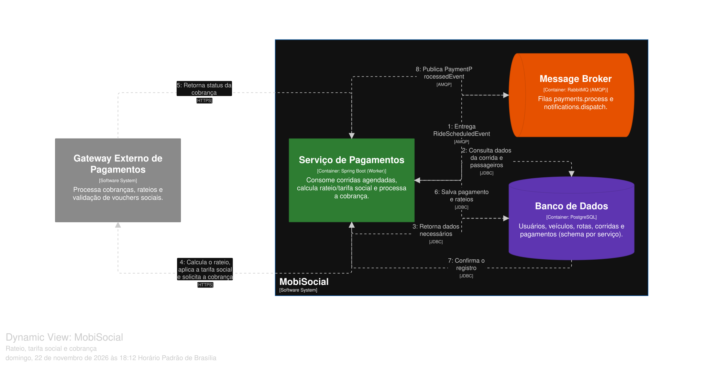

O Serviço de Pagamentos recebe `RideScheduledEvent`, consulta os dados necessários no PostgreSQL, calcula o rateio e aplica a tarifa social. Em seguida, solicita a cobrança ao Gateway Externo, salva o resultado no banco e publica `PaymentProcessedEvent` no broker.

#### 4. Notificação
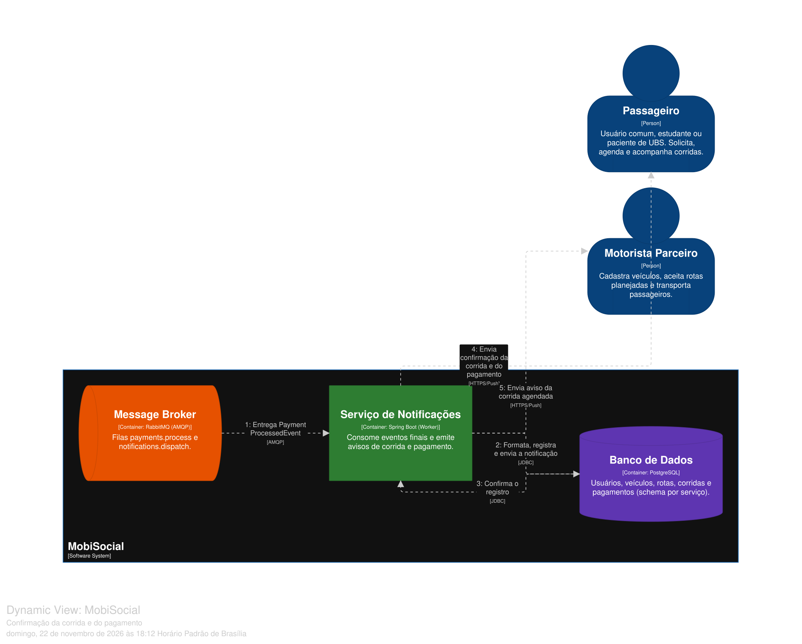

O Serviço de Notificações consome `PaymentProcessedEvent`, formata e registra a confirmação no PostgreSQL e envia o resultado ao Passageiro e ao Motorista.

## 3. C4 Nível 3: Diagramas de Componentes

### Serviço de Usuários
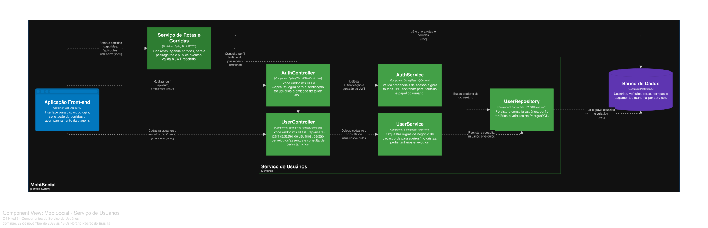

O **Serviço de Usuários** recebe requisições do **Front-end** via **HTTPS/REST** (JSON) nos controladores `AuthController` (`/api/auth`) e `UserController` (`/api/users`). O `AuthController` delega ao `AuthService` a validação de credenciais e a emissão do token **JWT**, enquanto o `UserController` delega ao `UserService` o cadastro de passageiros e motoristas, a gestão de veículos/assentos e a consulta de perfis tarifários (`COMUM`, `ESTUDANTE`, `SOCIAL`). Além disso, o `UserController` atende requisições internas via **HTTP/REST** do **Serviço de Rotas e Corridas** (`UserServiceClient`) para verificação de perfil tarifário, e os dados de usuários e veículos são persistidos no **PostgreSQL** por meio do `UserRepository` (**JDBC**).

### Serviço de Rotas e Corridas
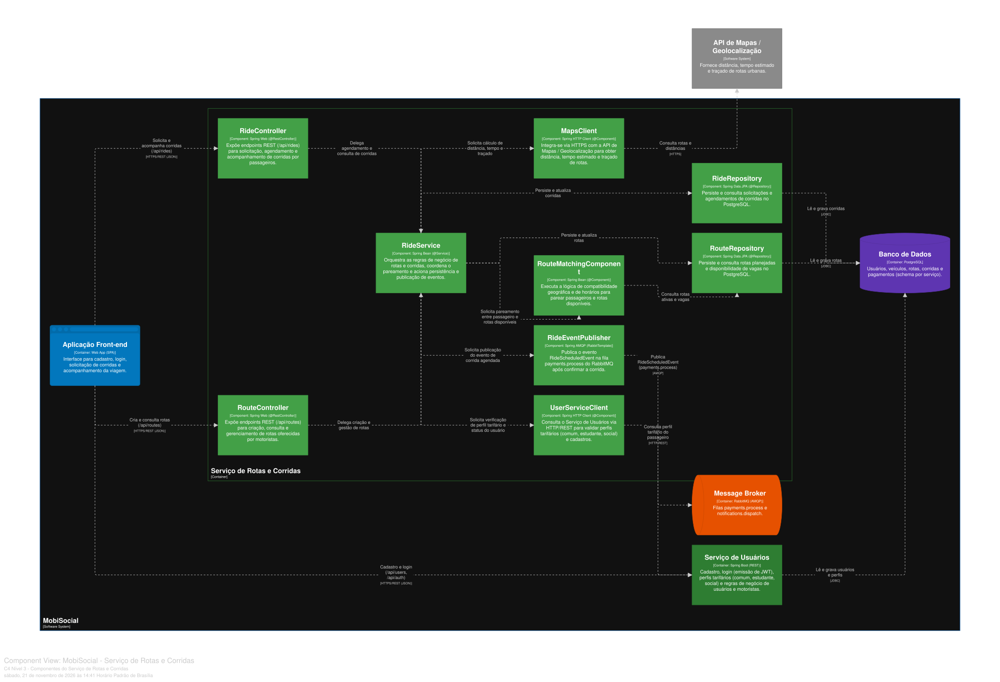

O **Serviço de Rotas e Corridas** recebe requisições do **Front-end** via **HTTPS/REST** (JSON) nos controladores `RouteController` (`/api/routes`) e `RideController` (`/api/rides`), delegando as regras de negócio ao `RideService`. O `RideService` utiliza o `RouteMatchingComponent` para parear passageiros e rotas compatíveis, consulta o perfil tarifário no **Serviço de Usuários** via `UserServiceClient` (**HTTP/REST**), calcula rotas e distâncias na **API de Mapas / Geolocalização** via `MapsClient` (**HTTPS**), persiste rotas e corridas no **PostgreSQL** por meio de `RouteRepository` e `RideRepository` (**JDBC**) e publica o evento `RideScheduledEvent` na fila `payments.process` do **RabbitMQ** através do `RideEventPublisher` (**AMQP**).

### Message Broker (RabbitMQ — Filas AMQP)
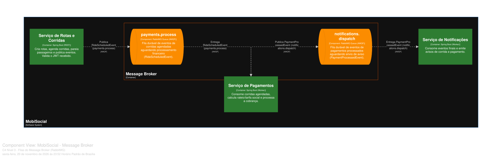

O Message Broker organiza o fluxo assíncrono em duas filas duráveis via **AMQP**: `payments.process`, que recebe o evento `RideScheduledEvent` do **Serviço de Rotas e Corridas** e o entrega ao **Serviço de Pagamentos**, e `notifications.dispatch`, que recebe o evento `PaymentProcessedEvent` do **Serviço de Pagamentos** e o entrega ao **Serviço de Notificações**.

### Serviço de Pagamentos
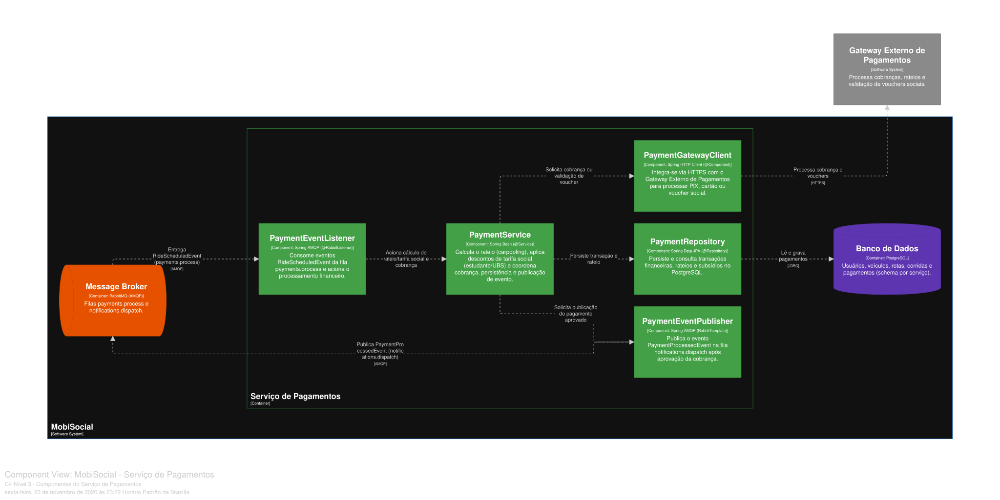

O `PaymentEventListener` consome o evento `RideScheduledEvent` da fila `payments.process` (**AMQP**) e aciona o `PaymentService`, responsável pelo cálculo de rateio (*carpooling*) e aplicação de tarifa social (estudante/UBS). O `PaymentService` solicita a cobrança ao **Gateway Externo de Pagamentos** via `PaymentGatewayClient` (**HTTPS**), persiste a transação no **PostgreSQL** via `PaymentRepository` (**JDBC**) e dispara o evento `PaymentProcessedEvent` na fila `notifications.dispatch` por meio do `PaymentEventPublisher` (**AMQP**).

### Serviço de Notificações
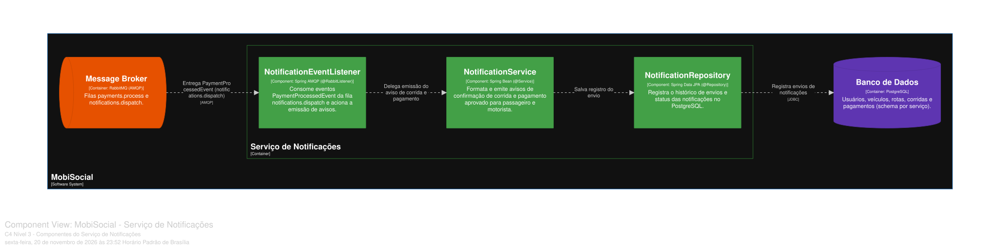

O `NotificationEventListener` consome o evento `PaymentProcessedEvent` da fila `notifications.dispatch` (**AMQP**) e delega ao `NotificationService` a formatação e emissão dos avisos de corrida e pagamento aprovado. Em seguida, o `NotificationRepository` grava o histórico de envios no **PostgreSQL** via **JDBC**.

## 4. C4 Nível 4: Diagramas de Código e Classes

### 4.1. Diagramas de Código no Structurizr (`workspace.dsl`)

#### Serviço de Rotas e Corridas (Classes, Interfaces JPA, Entidades e Eventos)
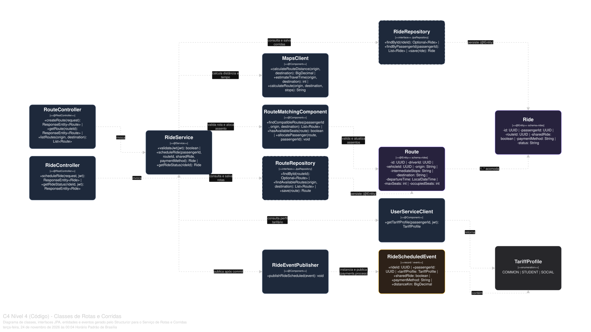

Modela as classes (`RouteController`, `RideController`, `RideService`, `RouteMatchingComponent`, `UserServiceClient`, `MapsClient`, `RideEventPublisher`), interfaces JPA (`RouteRepository`, `RideRepository`), entidades (`Route` e `Ride`, no schema `rides`) e contratos de evento (`RideScheduledEvent` e `TariffProfile`) do pacote `br.ufc.quixada.arquitetura.mobisocial.ride`.

#### Serviço de Pagamentos (Classes, Interface JPA, Entidade e Eventos)
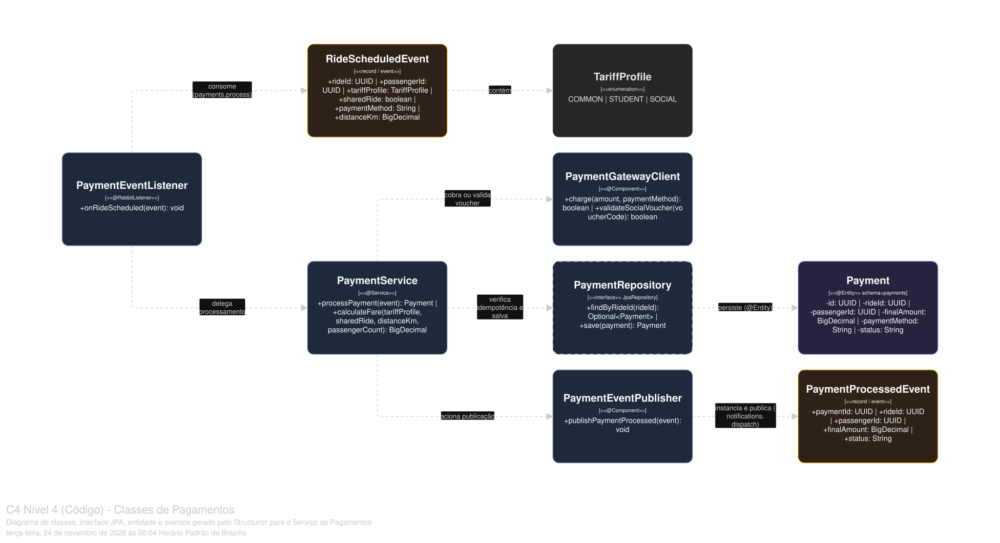

Modela o consumidor AMQP (`PaymentEventListener`), o serviço de cálculo de rateio e tarifa social (`PaymentService`), o cliente HTTPS do gateway (`PaymentGatewayClient`), a interface JPA (`PaymentRepository`), a entidade `Payment` (no schema `payments`), o publicador (`PaymentEventPublisher`) e os eventos `RideScheduledEvent` e `PaymentProcessedEvent`.

### 4.2. Diagramas de Classes (Mermaid — Detalhamento por Serviço)

#### Serviço de Usuários

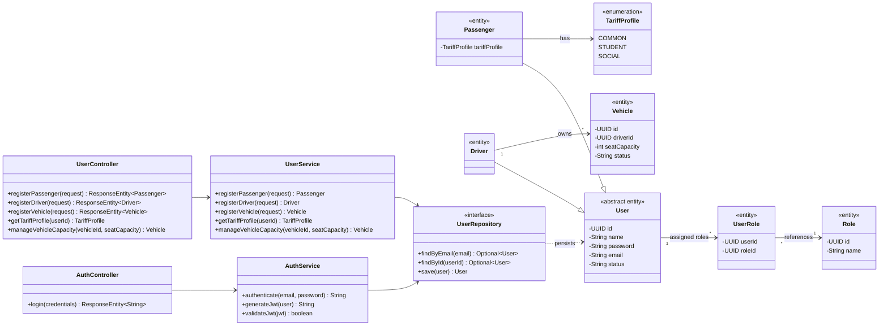

#### Serviço de Rotas e Corridas

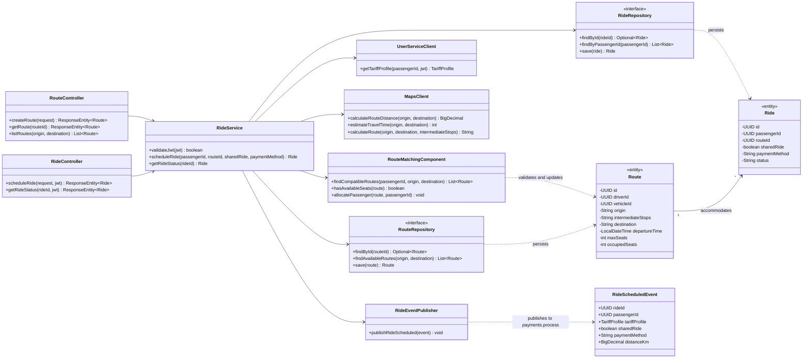

#### Serviço de Pagamentos

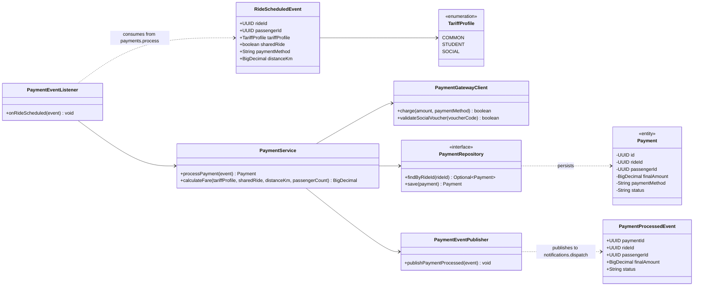

#### Serviço de Notificações

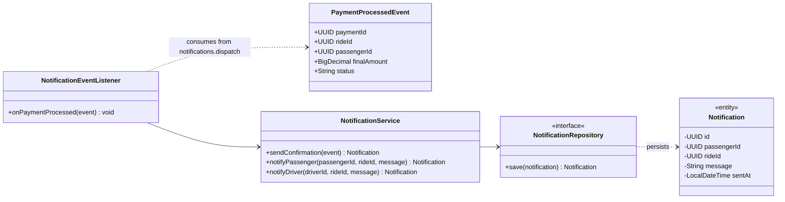
